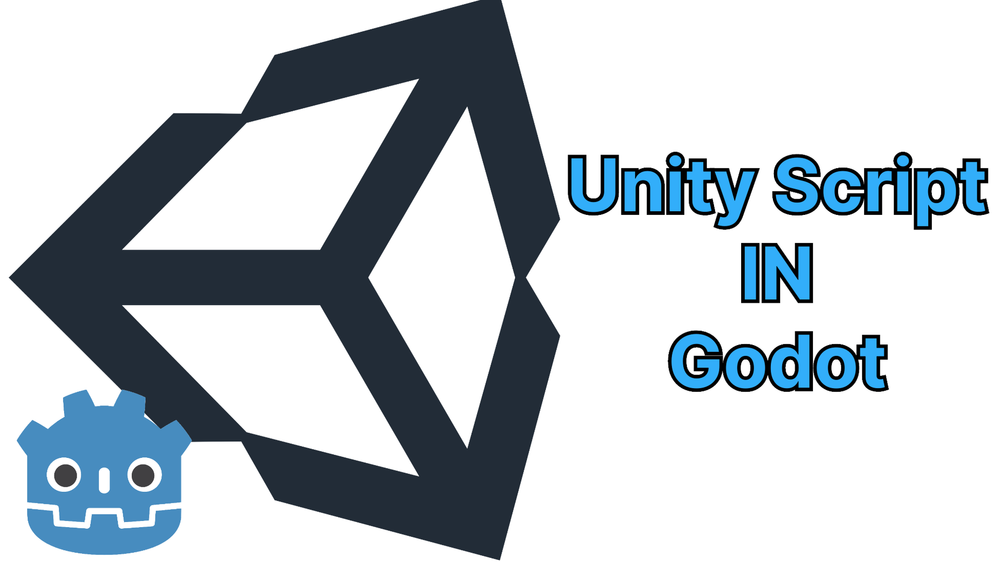

# Unity-CS
)
This is a Godot plugin that allows you to create scripts using Unity scripting without needing a computer or .NET. 

# ATTENTION! 
The plugin isn't on Godot Assets yet because they're still reviewing it! 

Godot assets profile:
[Her:](https://store.godotengine.org/publisher/ze-vide-studio/) 
